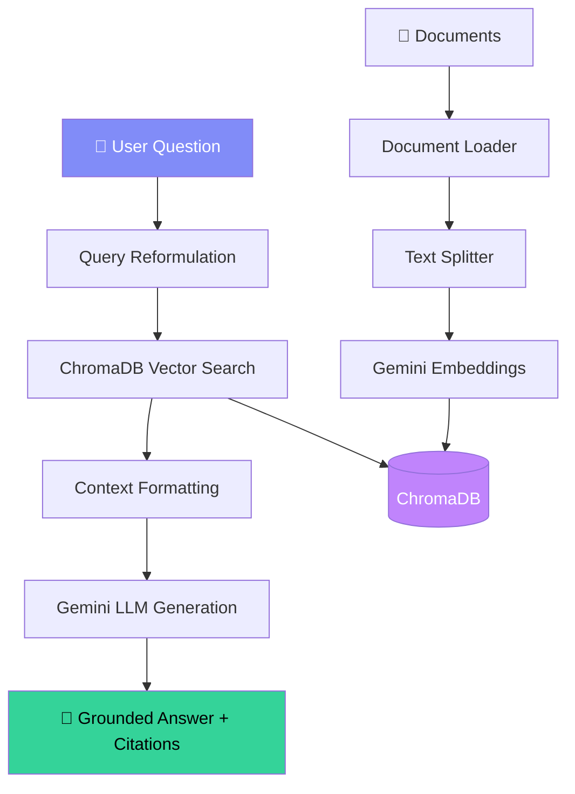

# RAG Chatbot — Architecture & Prompt Engineering

## 🏗️ System Architecture



## 📁 Project Files

| File | Purpose |
|------|---------|
| [`app.py`](file:///c:/Users/tanik/Desktop/RAG-chatbot/app.py) | FastAPI server with REST API endpoints |
| [`config.py`](file:///c:/Users/tanik/Desktop/RAG-chatbot/config.py) | Centralized settings via environment variables |
| [`document_processor.py`](file:///c:/Users/tanik/Desktop/RAG-chatbot/document_processor.py) | Multi-format document loading & chunking |
| [`vector_store.py`](file:///c:/Users/tanik/Desktop/RAG-chatbot/vector_store.py) | ChromaDB vector store management |
| [`rag_chain.py`](file:///c:/Users/tanik/Desktop/RAG-chatbot/rag_chain.py) | LangChain RAG pipeline orchestration |
| [`prompts.py`](file:///c:/Users/tanik/Desktop/RAG-chatbot/prompts.py) | **Prompt engineering templates** (anti-hallucination) |

## 🛡️ Prompt Engineering — Anti-Hallucination Strategies

All strategies are implemented in [`prompts.py`](file:///c:/Users/tanik/Desktop/RAG-chatbot/prompts.py):

### 1. Grounding Instructions
> *"Base your answer EXCLUSIVELY on the information found in the `<context>` section"*

The model is explicitly told its only knowledge source is the provided context. This is the most fundamental anti-hallucination technique.

### 2. Chain-of-Thought (CoT) Reasoning
> *"Step 1: Identify relevant parts... Step 2: Check completeness... Step 3: Formulate... Step 4: Verify... Step 5: Cite"*

Forcing step-by-step reasoning before answering significantly improves factual accuracy by making the model systematically validate its claims.

### 3. Confidence Calibration
> *"If the context does not contain enough information... you MUST explicitly say so"*

Instead of guessing when uncertain, the model is required to express uncertainty. This prevents the common failure mode of confident hallucination.

### 4. Source Attribution
> *"For every factual claim, cite the source document using [Source: filename] notation"*

Mandatory citations create a verification mechanism — both the user and the system can trace claims back to source documents.

### 5. Negative Instruction
> *"Do NOT use prior knowledge, training data, or assumptions to fill gaps"*

Explicitly stating what the model should NOT do is more effective than only stating what it should do.

### 6. Role Prompting
> *"You are a precise, knowledgeable research assistant"*

Assigning a role of precision and knowledge focuses the model's behavior toward accuracy rather than creativity.

### 7. Output Format Control
> *"Use bullet points or numbered lists for multi-part answers"*

Structured output formats reduce free-form text generation where hallucination is most likely to occur.

### 8. Context Window Management
> *"`<context>` ... `</context>` / `<question>` ... `</question>`"*

XML-like tags create clear boundaries between source context and the query, preventing context bleeding and confusion.

### 9. Fallback Behavior
> *"This question falls outside the scope of the uploaded documents"*

Defining explicit behavior for edge cases (no relevant context, out-of-scope questions) prevents the model from improvising.

### 10. Query Reformulation
Implemented as a separate LLM call that optimizes the user's query before retrieval. Better queries → more relevant chunks → fewer information gaps → less hallucination.

## ⚙️ RAG Pipeline Parameters

| Parameter | Value | Rationale |
|-----------|-------|-----------|
| **Temperature** | `0.1` | Very low for factual accuracy |
| **Top-P** | `0.85` | Focused token sampling |
| **Chunk Size** | `1000 chars` | Balance between context and specificity |
| **Chunk Overlap** | `200 chars` | Prevents information loss at boundaries |
| **Top-K Results** | `5` | Enough context without noise |
| **Similarity Threshold** | `0.3` | Filters out irrelevant chunks |

## 🚀 Getting Started

```bash
# 1. Add your Gemini API key
cp .env.example .env
# Edit .env and set GOOGLE_API_KEY

# 2. Install dependencies
pip install -r requirements.txt

# 3. Run the server
python app.py

# 4. Open http://localhost:8000
```
